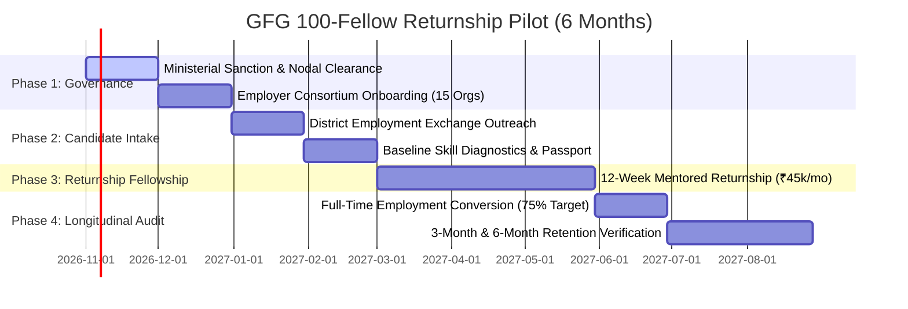

# GFG 2.0 — Career Continuity, Returnship & Government Pilot Platform

> **RETURN. REBUILD. RISE.**  
> A minimal, cinematic editorial career platform engineered to help women rebuild skills, regain confidence, and transition into dignified returnships and leadership after life breaks—with zero career-gap algorithmic penalties.

---

## 🌟 Executive Summary & Mission

GFG 2.0 addresses India's systemic female labor force drop-off (48% mid-career exit rate, ASSOCHAM/Catalyst) by replacing arbitrary automated ATS filtering with an immutable **Career Continuity Passport**, low-anxiety adaptive roadmaps, non-discriminatory opportunity matching, and state skill scheme alignment.

All platform components strictly align with the **Digital Personal Data Protection Act (DPDP Act 2023, India)**, enforce server-side Role-Based Access Control (RBAC), and adhere to transparent **Responsible AI** principles with zero autonomous rejection decisions.

---

## 🏛️ System Architecture

```
GFG 2.0/
├── backend/                              # FastAPI Python 3.10+ High-Performance REST API
│   ├── app/
│   │   ├── config/settings.py            # Pydantic environment configuration (No hardcoded secrets)
│   │   ├── database/database.py          # SQLAlchemy Session & Engine binding (SQLite / PostgreSQL)
│   │   ├── middleware/                   # JWT RBAC verification & request audit logging
│   │   ├── models/                       # Data entities: User, CandidateProfile, Job, Application, Company
│   │   ├── schemas/                      # Pydantic V2 validation & DTO serialization schemas
│   │   ├── routers/                      # Modular API Route Controllers:
│   │   │   ├── auth.py                   # Secure JWT login, registration & role provisioning
│   │   │   ├── candidates.py             # Profile management, skills, projects, break visibility
│   │   │   ├── jobs.py                   # Opportunities, returnships, employer listings
│   │   │   ├── applications.py           # Application lifecycle & structured recruiter reviews
│   │   │   ├── uploads.py                # Server-authorized document & avatar storage
│   │   │   ├── government_pilot.py       # Module 11 verified metrics, Tamil Nadu schemes & exports
│   │   │   ├── privacy.py                # Module 12 DPDP Act notice, consent, export & erasure
│   │   │   ├── responsible_ai.py         # Module 12 AI dossier, challenge mechanism & bias audit
│   │   │   └── admin.py                  # System security audit & safe demo reset function
│   │   └── services/                     # Matching formulas, DAG roadmaps & cryptographic passports
│   ├── database/seed.py                  # Baseline demonstration data seeder
│   ├── storage/                          # Local sandboxed file storage (resumes & avatars)
│   └── tests/                            # Automated test suite (94 passing tests)
│
├── my-website/                           # Next.js 16 (App Router) + React 19 + Vanilla/Tailwind CSS
│   ├── src/app/
│   │   ├── layout.tsx                    # Root layout with editorial font variables & theme
│   │   ├── page.tsx                      # Primary editorial platform with interactive modules
│   │   └── minister-presentation/        # Dedicated 10-section official briefing route
│   ├── src/components/                   # Accessible WCAG 2.2 AA UI Components:
│   │   ├── EditorialNavigation.tsx       # Desktop & mobile nav with role switcher
│   │   ├── GovernmentPilotModal.tsx      # Multi-view pilot dashboard & SDG matrix
│   │   ├── UserDashboardModal.tsx        # DPDP consent settings, data export & erasure
│   │   ├── ScoringExplanationModal.tsx   # Responsible AI transparency & challenge trigger
│   │   ├── CareerPassportModal.tsx       # SHA-256 cryptographic credential generator
│   │   ├── EmployerIntelligenceModal.tsx # Nova Tech returnship recruiter workspace
│   │   └── IntelligentOnboardingModal.tsx# Low-anxiety onboarding & capacity settings
│   └── src/lib/                          # Frontend utilities:
│       ├── api.ts                        # Typed client with robust offline demonstration fallbacks
│       ├── demoPersona.ts                # Canonical persona: Ananya Raman & Nova Tech
│       └── dataClassification.ts         # Data confidentiality labeling system
│
└── gfg_local.db                          # Local SQLite database (offline demo fallback)
```

---

## 📋 Comprehensive Feature Inventory

| Module | Name | Key Capabilities |
| :--- | :--- | :--- |
| **01** | **Editorial Visual Identity** | Cinematic warm cream palette (`#111111`, `#D8C2A6`, `#A56F7C`), serif typography, micro-animations. |
| **02** | **Authentication & RBAC** | Server-side role gating (`candidate`, `employer`, `mentor`, `admin`), JWT bearer tokens, bcrypt hashing. |
| **03** | **Candidate Discovery & Onboarding** | Pacing selection (2–8 hrs/day), hybrid/remote preferences, masked career break reasons. |
| **04** | **Skills & Adaptive Roadmap** | Diagnostic gap calibration, prerequisite DAG sequencing, weekly human mentor touchpoints. |
| **05** | **Career Continuity Passport** | SHA-256 tamper-evident hash, verified pre-break tenure, proctored challenge achievements. |
| **06** | **Employer Desk (Nova Tech)** | 12-week fellowship creator, stipend parity enforcement (₹45k/mo), structured human rubrics. |
| **07** | **Work-Life & Community** | Childcare directory, emotional resilience circles, mentor booking with Dr. Meera Iyer. |
| **08** | **Entrepreneurship Hub** | Micro-enterprise incubation tracks, business plan templates, state MSME grant guidance. |
| **09** | **Digital Twin & Simulation** | Future-looking scenario modeling, compensation projections, skill refresh impact sliders. |
| **10** | **Accessibility & Comfort** | WCAG 2.2 AA compliance, low-bandwidth data saver mode, spoken voice guide integration. |
| **11** | **Government Pilot Analytics** | Verified TN schemes (Pudhumai Penn, TNASDI, VKP), UN SDG (4, 5, 8, 10) alignment, CSV/JSON reporting. |
| **12** | **Security & Responsible AI** | DPDP Act 2023 compliance, data portability export, non-punitive career break bias invariant, Minister Briefing deck (`/minister-presentation`). |

---

## 🔒 Security Audit & Responsible AI Dossier

### 1. Security Posture
- **No Client-Only Reliance:** Sensitive endpoints (`/api/admin/*`, `/api/upload/resumes/*`, `/api/privacy/*`) enforce server-side session and role validation.
- **Path Traversal Protection:** File IDs are stripped of relative path components (`..`, `/`, `\`) and verified against disk boundaries.
- **Document Access Authorization:** Resumes are strictly inaccessible to third parties. Only the candidate owner, vetted employers with active applications, or platform administrators can retrieve documents.
- **Zero Public Localhost Hardcoding:** Production deployments cleanly separate origin configurations via environment variables (`FRONTEND_URL`, `DATABASE_URL`).

### 2. Privacy & DPDP Act 2023 Alignment
- **Notice & Consent:** Transparent disclosures detailing lawful purpose, grievance redressal, and retention limits (`GET /api/privacy/policy`).
- **Data Portability:** Candidates can download their complete profile, application history, and skill ledger in standard JSON (`GET /api/privacy/export-data`).
- **One-Click Revocation:** Candidates can immediately revoke employer sharing consent, defaulting visibility back to private (`POST /api/privacy/revoke-all-consent`).
- **Right to Erasure:** Formal deletion request submission with 7-day administrative SLA (`POST /api/privacy/erasure-request`).

### 3. Responsible AI Principles
- **No Autonomous Rejections:** AI compatibility scoring is strictly advisory. Employment rejection decisions require human recruiter evaluation.
- **Career Break Neutrality:** Scoring invariants guarantee that candidates with 5+ year career breaks receive equal consideration compared to shorter hiatuses when competencies match.
- **Algorithmic Opt-Out:** Candidates can opt out of automated ranking to view all opportunities chronologically without scoring (`POST /api/responsible-ai/opt-out`).
- **Dispute & Challenge:** Candidates can challenge perceived inaccuracies in recommendation models, routing to a human advisor review (`POST /api/responsible-ai/challenge-recommendation`).

---

## 🚀 Setup & Execution Instructions

### 1. Prerequisites
- **Python**: 3.10 or higher
- **Node.js**: 18.x or higher
- **npm**: 9.x or higher

### 2. Backend Setup
```bash
# From workspace root:
cd "c:\Users\TRB\modified mindspace sdg\CrediAI\GFG 2.0"

# Install backend dependencies:
pip install -r backend/requirements.txt

# Start backend server:
python -m uvicorn backend.app.main:app --host 127.0.0.1 --port 8000 --reload
```
- **API Documentation (Swagger UI)**: [http://127.0.0.1:8000/docs](http://127.0.0.1:8000/docs)
- **Health Check Endpoint**: [http://127.0.0.1:8000/health](http://127.0.0.1:8000/health)

### 3. Frontend Setup
```bash
# In a separate terminal:
cd "c:\Users\TRB\modified mindspace sdg\CrediAI\GFG 2.0\my-website"

# Install frontend dependencies:
npm install

# Start Next.js development server:
npm run dev
```
- **Live Platform**: [http://localhost:3000](http://localhost:3000)
- **Ministerial Briefing Page**: [http://localhost:3000/minister-presentation](http://localhost:3000/minister-presentation)

---

## 🧪 Testing Instructions

Run the full automated pytest suite across all 12 modules:
```bash
# Run all backend unit & integration tests:
python -m pytest backend/tests/ -v

# Run Module 12 Security, Privacy & Responsible AI tests specifically:
python -m pytest backend/tests/test_module12_security_responsible_ai.py -v

# Verify frontend TypeScript compilation with zero type errors:
cd my-website
npx tsc --noEmit
```
*Current Status: 94/94 backend tests passing; TypeScript compilation 100% clean.*

---

## 👥 Canonical Demonstration Personas

To ensure demonstration consistency across all flows, use the following pre-seeded credentials:

| Role | Name | Email | Password | Persona Context |
| :--- | :--- | :--- | :--- | :--- |
| **Candidate** | **Ananya Raman** | `ananya.raman@example.com` | `Password@123` | Senior Full-Stack Engineer returning after a 4-year caregiving hiatus. |
| **Employer** | **Nova Tech HR** | `hr@novatech.com` | `Password@123` | Fictional enterprise partner providing 12-week fellowship returnships. |
| **Mentor** | **Dr. Meera Iyer** | `mentor@gfg.com` | `Password@123` | Executive Engineering Mentor & Alumna Director. |
| **Admin** | **Platform Governance** | `admin@gfg.com` | `Password@123` | System auditor with security audit & demo reset permissions. |

---

## ⚠️ Known Limitations & Assumptions

1. **Non-Production Demonstration Environment:** The local deployment defaults to SQLite (`gfg_local.db`) for offline resilience. Production deployments should configure PostgreSQL via `DATABASE_URL`.
2. **Cryptographic Ledger:** Passports are verified using SHA-256 signatures generated on-chain within platform storage. Integration with national digital credential lockers (e.g., DigiLocker) is planned for Phase 2.
3. **Government Alignment Status:** References to Pudhumai Penn, TNASDI, and VKP represent verified official policy alignments and proposed technical integrations; formal administrative clearance is sought during pilot review.

---

## 🗺️ Pilot Deployment Roadmap



---

## 📄 License & Attribution

Developed for state workforce modernization and gender equality in technical labor markets.  
MIT © 2026 GFG Collective.
